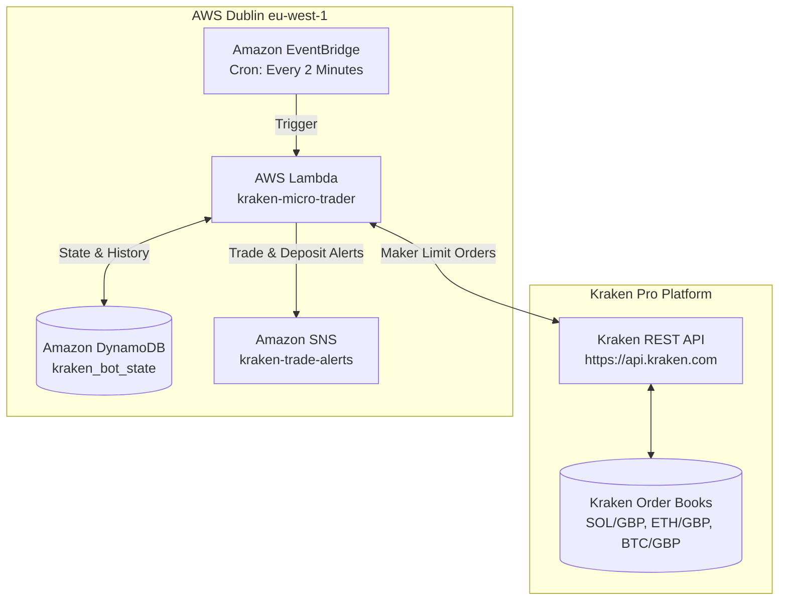

# Kraken Autonomous Micro-Grid Trading System

An institutional-grade, zero-cloud-cost (**£0.00/month** perpetual free tier) algorithmic trading platform executing a **2-Rung Micro-Grid Maker** strategy directly in **Pounds Sterling (£ GBP)** on **Kraken Pro** across major cryptocurrency pairs (`SOL/GBP`, `ETH/GBP`, `BTC/GBP`).

---

## 📚 Plain-English Beginner Guide

If you are new to automated algorithmic trading, read our friendly, jargon-free guide:

* 📖 **[The Idiot's Guide to Volatility Ping-Pong & Micro-Grids](docs/PING_PONG_EXPLAINED.md):** How the bot buys dips, sells slight pumps, captures daily market waves, compounds intraday volatility, and why it costs £0.00 in cloud fees.

---

## 1. High-Level Architecture

The bot runs 100% serverless inside AWS Dublin (`eu-west-1`), colocated within milliseconds of Kraken's European matching engines:



* **AWS Lambda:** Executes every 2 minutes, evaluates open orders, calculates volatility, and places Maker limit orders.
* **Amazon DynamoDB (`kraken_bot_state`):** Persists order IDs, rung states, entry prices, and cumulative realized profits across cycles.
* **Amazon SNS (`kraken-trade-alerts`):** Delivers immediate email notifications for order placements, sell fills, profit lock-ins, and bank deposits.
* **Monthly Cloud Cost:** **£0.00 / month** (well within the perpetual AWS Free Tier for Lambda, DynamoDB, and EventBridge).

---

## 2. The 2-Rung Micro-Grid Strategy

Rather than committing 100% of a pair's capital into a single order, each trading pair is partitioned into a **2-Rung Micro-Grid** (50% / 50% split). This unlocks continuous compounding on intraday chop while maintaining a dedicated reserve to capitalise on sudden market dips:

```
Pair Allocation (e.g. £25.40 in SOLGBP)
 │
 ├── Rung 1 (50% = £12.70): High-Frequency Scalp
 │     • Shallow Dip Buy: 0.40% – 0.80% below market
 │     • Tight Target Sell: +0.80% – +1.20%
 │     • Role: Flips multiple times daily during sideways chop
 │
 └── Rung 2 (50% = £12.70): Deep Dip Harvester
       • Deep Dip Buy: 1.20% – 2.00% below market
       • Wider Target Sell: +1.20% – +2.50%
       • Role: Scoops sharp flash dips and captures strong mean-reversion bounces
```

### Core Execution Principles:
1. **100% Maker Orders (Post-Only):** All orders are placed with `oflags = post`. If an order would cross the spread as a taker, Kraken rejects it instantly. This guarantees you always pay Kraken's lowest Maker fee tier (0.25%) and never suffer slippage.
2. **Dynamic Volatility Pricing (ATR):** The bot continuously queries 24-hour candlestick data (`OHLC`), computing real-time swing percentages to dynamically widen profit targets during high-volatility expansions and tighten them during quiet consolidations (clamped between `0.8%` and `3.0%`).
3. **Zero Stranded Capital:** If the market dips, the bot holds physical crypto securely in your Kraken account until the target sell limit fills. It **never panic-sells** at a loss.
4. **Permanent Fee Buffer Protection:** The bot never exhausts cash. A permanent buffer of `max(£2.00, 3% of equity)` is ring-fenced from trading, guaranteeing orders are never rejected due to fee depletion.
5. **Automatic Deposit Detection:** On each 2-minute cycle, the bot monitors for incoming GBP bank deposits ($\ge £5.00$). When detected, it dynamically increases order sizes and notifies you via email.

---

## 3. Dynamic Capital Allocation

All account equity is automatically pooled and divided evenly across your configured pairs (`SOLGBP`, `ETHGBP`, `BTCGBP`):

$$\text{Tradeable Pool} = \max(0, \text{Total Portfolio Equity} - \mathbf{£2.00 \text{ (Fee Buffer)}})$$

$$\text{Per-Pair Target} = \frac{\text{Tradeable Pool}}{N \text{ (Active Pairs)}}$$

$$\text{Per-Rung Capital} = \frac{\text{Per-Pair Target}}{2}$$

```
Total Portfolio Equity: £78.51 (Free Cash + Crypto Value)
 │
 ├── Permanent Uncommitted Fee Buffer: £2.36 (Safety reserve for exchange fees)
 └── Tradeable Capital Pool:          £76.16
       ├── SOLGBP Allocation:          £25.39 (Rung 1: £12.69 | Rung 2: £12.70)
       ├── ETHGBP Allocation:          £25.39 (Rung 1: £12.69 | Rung 2: £12.70)
       └── BTCGBP Allocation:          £25.39 (Rung 1: £12.69 | Rung 2: £12.70)
```

---

## 4. Daily Operations & CLI Cheat Sheet

### View Live Portfolio Dashboard:
```bash
python3 src/status.py
```

Sample output:
```text
============================================================
               KRAKEN MICRO-TRADER STATUS
============================================================
  Active Strategy:   Serverless 2-Rung Micro-Grid (AWS Lambda £0.00/mo)
  Trading Pairs:     SOLGBP, ETHGBP, BTCGBP
  Total Portfolio:   £78.51 (Free Cash: £19.79)
  Fee Buffer Held:   £2.36 (Permanent 3% / min £2.00 Safety Reserve)
  Tradeable Pool:    £76.16 (£25.39/pair across 3 pairs)

------------------------------------------------------------
  Trading Pair:      BTCGBP (BTCGBP-PINGPONG)
  Strategy Mode:     2-RUNG MICRO-GRID (Compounding Intraday Dips)
  • Rung 1 (50%):     BUY_PLACED @ £63509.3 (-0.60% dip) | Target: +1.00%
  • Rung 2 (50%):     IDLE (Queued to deploy buy order)
  Completed Cycles:  1
  Realized Profit:   +£0.1675
============================================================
```

### Inspect Live Lambda Execution Logs:
```bash
aws logs tail /aws/lambda/kraken-micro-trader --region eu-west-1 --follow
```

### Pause / Resume Trading:
```bash
# Pause bot (disables 2-minute EventBridge cron trigger)
aws events disable-rule --name kraken-trader-schedule --region eu-west-1

# Resume bot (re-enables 2-minute cron trigger)
aws events enable-rule --name kraken-trader-schedule --region eu-west-1
```

---

## 5. Automated Testing

The repository includes a comprehensive unit test suite covering dynamic capital allocation, fee buffer safety rules, volatility math, deposit detection, and micro-grid state transitions:

```bash
PYTHONPATH=src python3 -m unittest discover -s tests -p "test_*.py"
```

---

## 6. Security & Safety Principles

1. **Restricted API Keys:** Kraken API credentials require only **"Query Funds"** and **"Create & Cancel Orders"**. Withdrawal and funding permissions must remain permanently disabled.
2. **Encrypted Parameter Storage:** Kraken API keys are stored in AWS Systems Manager (SSM) Parameter Store as `SecureString` types encrypted with AWS KMS.
3. **No Open Inbound Ports:** The bot runs serverlessly in AWS Lambda without exposing any open ports or listening services.
4. **Permanent Fee Protection:** Neither market volatility nor balance fluctuations can deplete your trading fee cash floor.
