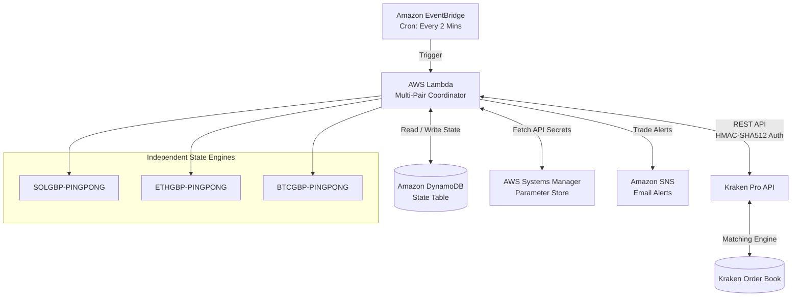

# Kraken Micro-Trader (AWS Serverless)

An autonomous, low-cost cryptocurrency micro-trading bot running on AWS Lambda. It executes a **Ping-Pong / Limit-Order Mean-Reversion** strategy directly in **Pounds Sterling (£ GBP)** on **Kraken Pro** (e.g., `SOL/GBP`, `ETH/GBP`, `BTC/GBP`).

---

## 1. Overview & Strategy

The bot is designed to trade with modest starter capital (**£50**) while maximizing fee efficiency and avoiding cloud hosting costs:

* **Maker-Only Limit Orders:** Submits limit orders directly to Kraken's order book. This qualifies for Kraken Pro's lower Maker fee (**0.25%**) instead of the 0.40% Taker fee, eliminating market slippage.
* **Native GBP Trading:** Trades directly in British Pounds. No currency conversions, no stablecoin exchange rate risks, and no wire transfer fees.
* **Ping-Pong Cycle:**
  1. `BUY`: Submits a Limit Buy order at/slightly below current market bid.
  2. `WAIT`: Kraken's matching engine monitors the market 24/7. Lambda only wakes up periodically to check fill status.
  3. `SELL`: When the buy order fills, the bot immediately calculates the target profit price (`+0.8%` to `+3.0%` net of fees) and places a Limit Sell order.
  4. `REPEAT`: When the sell order fills, profit is locked in, and a new re-entry buy order is queued.
* **Dynamic Half-Spread Volatility Engine:** Rather than relying on a static target, the bot evaluates the trailing 24-hour candlestick spread (`(High - Low) / Low`). It takes **50% of the daily spread** (the average mean-to-extreme amplitude), and aims to capture **75% of that half-spread** (`Spread % * 0.375`). Clamped between `0.8%` and `3.0%`, this ensures the profit target stays realistically within reach without needing to break daily highs.
* **Multi-Pair Concurrent Scaling:** A single Lambda and DynamoDB table can trade multiple uncorrelated pairs (e.g. `SOLGBP,ETHGBP,BTCGBP`) concurrently with independent state machines and zero extra infrastructure cost.
* **100% Free-Tier Architecture:** Built on AWS serverless primitives (Lambda, EventBridge, DynamoDB, Systems Manager, SNS), resulting in £0.00 monthly cloud hosting costs.

---

## 2. Architecture



---

## 3. Dynamic Volatility Formula

To prevent placing sell orders stranded above recent market resistance, the bot dynamically calculates profit targets using the trailing 24-hour hourly candles:

$$\text{24h Spread \%} = \frac{\text{24h High} - \text{24h Low}}{\text{24h Low}} \times 100$$

$$\text{Dynamic Target \%} = (\text{24h Spread \%} \times 0.50) \times 0.75$$

$$\text{Target Sell Price} = \text{Entry Buy Price} \times \left(1 + \frac{\text{Dynamic Target \%} + \text{Round-Trip Fees (0.50\%)}}{100}\right)$$

* **Safety Clamps:** Targets are clamped between `0.8%` (minimum floor to guarantee fee coverage) and `3.0%` (maximum ceiling to maintain fast cycle turnover).

---

## 4. Example Trade Flow Walkthrough

Here is an end-to-end trace of how the bot handles orders across single and multi-pair operations:

### Scenario A: Single-Pair Cycle (`SOL/GBP`)

```text
[Step 1: IDLE ➔ BUY_PLACED]
  • Market Bid: £89.95
  • Maker Discount (0.2%): Buy Limit set to £89.95 (post-only)
  • Volume: £48.00 / £89.95 = 0.5336 SOL
  • Action: Limit Buy order OTI5HL... posted to Kraken order book.
  • State: Transition to BUY_PLACED in DynamoDB.

[Step 2: BUY_PLACED ➔ FILL DETECTED]
  • 2 minutes later, EventBridge invokes Lambda.
  • Kraken reports order OTI5HL... is "closed" (filled @ £89.95).
  • Capital Deployed: £48.00. Holding: 0.5336 SOL.

[Step 3: DYNAMIC VOLATILITY PRICING]
  • Bot analyzes last 24h hourly candles:
    - 24h Low: £88.81 | 24h High: £92.36 (Spread: 4.00%)
    - 50% Half-Spread: 2.00%
    - 75% Capture Target: +1.50% net profit
  • Gross Markup: +1.50% (net) + 0.50% (fees) = +2.00%
  • Target Sell Price: £89.95 * 1.02 = £91.75 (or £90.85 fast target)

[Step 4: SUBMIT LIMIT SELL]
  • Submits post-only Limit Sell: 0.5336 SOL @ £91.75.
  • Action: Order OED4YA... posted to Kraken order book.
  • State: Transition to SELL_PLACED in DynamoDB.
  • Alert: Amazon SNS sends trade confirmation email to user.

[Step 5: SELL FILL & PROFIT REALIZATION]
  • SOL spikes to £92.10 during the day; order fills at £91.75!
  • Gross Revenue: 0.5336 * £91.75 = £48.96
  • Kraken Maker Fees (0.25% buy + 0.25% sell): £0.24
  • Net Profit Locked In: +£0.72 (+1.50% ROI on the £48 allocation)
  • DynamoDB Updated: trades_completed = 1, total_realized_profit_gbp = £0.72

[Step 6: AUTOMATIC RE-ENTRY]
  • Re-entry price calculated below £91.75 exit.
  • New Limit Buy order immediately submitted on Kraken.
  • Cycle repeats automatically.
```

---

### Scenario B: Concurrent Multi-Pair Ping-Pong (`SOL/GBP` + `ETH/GBP`)

When multiple pairs are enabled, each pair operates as an isolated state machine:

```text
EventBridge Trigger (Every 2 Minutes)
  │
  ├── Pair 1: SOLGBP-PINGPONG (State: SELL_PLACED)
  │     • Checks resting sell order @ £90.85.
  │     • Order still open (waiting).
  │     • Action: No change, continues holding 0.5336 SOL.
  │
  └── Pair 2: ETHGBP-PINGPONG (State: BUY_PLACED)
        • Checks resting buy order @ £2,010.50.
        • Fill detected!
        • Evaluates ETH 24h volatility spread (3.2%).
        • Immediately posts Limit Sell @ £2,034.60 (+1.2% net).
        • State transitions to SELL_PLACED.
```

---

## 5. Financial Model (£50 Starting Capital)

| Parameter | Default Value | Description |
| :--- | :--- | :--- |
| **Trading Pair(s)** | `SOLGBP`, `ETHGBP` | High liquidity on Kraken, frequent 2-4% daily oscillations |
| **Capital per Pair** | `£40.00 – £48.00` | Capital allocated per cycle (leaving buffer for fee rounding) |
| **Dynamic Target** | `+0.80% – +3.00%` | Half-spread capture calibrated to prevailing 24h market swing |
| **Maker Fee (Buy)** | `0.25%` | Standard Kraken Pro maker fee tier |
| **Maker Fee (Sell)**| `0.25%` | Standard Kraken Pro maker fee tier |
| **Total Round-Trip Fee**| `0.50%` | Fixed fee cost per completed cycle (~£0.24 on £48) |
| **Net Profit / Cycle** | `+£0.24 – +£0.80` | Realized profit locked in per trade after all fees |

---

## 6. Multi-Pair "Switch" Configuration

To scale from single-pair to multi-pair trading:

1. Open `terraform/terraform.tfvars`:
   ```hcl
   # Single pair:
   trading_pairs = "SOLGBP"

   # Multi-pair:
   trading_pairs = "SOLGBP,ETHGBP"
   ```
2. Apply with OpenTofu:
   ```bash
   cd terraform && tofu apply -auto-approve
   ```
3. The Lambda function automatically provisions the state for each pair and begins concurrent execution.

---

## 7. Security & Safety Controls

1. **Least-Privilege API Keys:** Uses Kraken API keys configured with **"Query Funds"** and **"Create & Cancel Orders"** only. Withdrawal permissions are disabled.
2. **Post-Only Orders (`oflags = post`):** Ensures all orders rest on the book as Maker orders. If an order would cross as a Taker (higher fee), Kraken rejects it automatically.
3. **Zero-Dependency Core:** Built using Python's standard library (`urllib`, `hmac`, `hashlib`, `json`, `decimal`).
4. **AWS Parameter Store:** API Key and Secret are encrypted in AWS SSM Parameter Store (`SecureString`) and fetched dynamically at runtime.

---

## 8. Daily Operations Cheat Sheet

```bash
# Check live multi-pair status (state, prices, active orders, realized profit)
python3 src/status.py

# Stream live execution logs in real-time
aws logs tail /aws/lambda/kraken-micro-trader --region eu-west-1 --follow

# Resume / Enable automated 2-minute trading
aws events enable-rule --name kraken-trader-schedule --region eu-west-1

# Pause / Disable automated trading
aws events disable-rule --name kraken-trader-schedule --region eu-west-1
```
