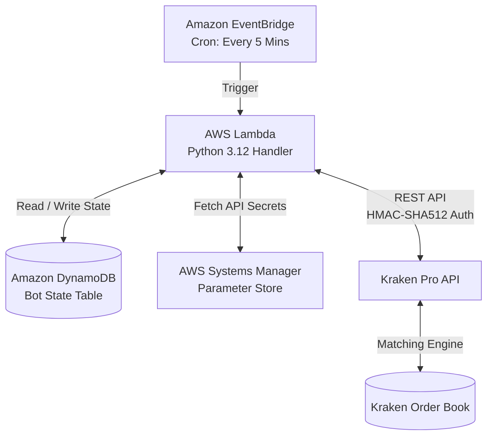

# Kraken Micro-Trader (AWS Serverless)

An autonomous, low-cost cryptocurrency micro-trading bot running on AWS Lambda. It executes a **Ping-Pong / Limit-Order Mean-Reversion** strategy directly in **Pounds Sterling (£ GBP)** on **Kraken Pro** (e.g., `SOL/GBP`, `ETH/GBP`, `BTC/GBP`).

---

## 1. Overview & Strategy

The bot is designed to trade with modest starter capital (**£50**) while maximizing fee efficiency and avoiding cloud hosting costs:

* **Maker-Only Limit Orders:** Submits limit orders directly to Kraken's order book. This qualifies for Kraken Pro's lower Maker fee (**0.25%**) instead of the 0.40% Taker fee, eliminating market slippage.
* **Native GBP Trading:** Trades directly in British Pounds. No currency conversions, no stablecoin exchange rate risks, and no wire transfer fees.
* **Ping-Pong Cycle:**
  1. `BUY`: Submits a Limit Buy order at/slightly below current market bid.
  2. `WAIT`: Kraken's matching engine monitors the market 24/7. Lambda only wakes up periodically to check fill status.
  3. `SELL`: When the buy order fills, the bot immediately calculates the target profit price (`+2.0%` net of fees) and places a Limit Sell order.
  4. `REPEAT`: When the sell order fills, profit is locked in, and a new re-entry buy order is queued.
* **100% Free-Tier Architecture:** Built on AWS serverless primitives (Lambda, EventBridge, DynamoDB, Systems Manager), resulting in £0.00 monthly cloud hosting costs.

---

## 2. Architecture



---

## 3. Financial Model (£50 Starting Capital)

| Parameter | Default Value | Description |
| :--- | :--- | :--- |
| **Trading Pair** | `SOL/GBP` (or `ETH/GBP`) | High liquidity on Kraken, frequent 2-4% daily oscillations |
| **Order Capital** | `£48.00` | Capital allocated per cycle (leaving £2 buffer for fee rounding) |
| **Target Gross Move** | `+2.00%` | Gross price swing targeted per cycle |
| **Maker Fee (Buy)** | `0.25%` | Standard Kraken Pro maker fee tier |
| **Maker Fee (Sell)**| `0.25%` | Standard Kraken Pro maker fee tier |
| **Total Round-Trip Fee**| `~0.50%` | Fixed fee cost per completed cycle (~£0.24) |
| **Net Profit / Cycle** | `~+1.50%` | Expected net profit locked in per trade (~£0.72) |

---

## 4. Security & Safety Controls

1. **Least-Privilege API Keys:** Uses Kraken API keys configured with **"Query Funds"** and **"Create & Cancel Orders"** only. Withdrawal permissions are disabled.
2. **Zero-Dependency Core:** Built using Python's standard library (`urllib`, `hmac`, `hashlib`, `json`, `decimal`). No heavy third-party wheels required in Lambda.
3. **Dry-Run Mode (`DRY_RUN = true`):** The bot queries live Kraken prices, calculates order math, and logs actions without submitting real orders to the exchange.
4. **AWS Parameter Store:** API Key and Secret are encrypted in AWS SSM Parameter Store (`SecureString`) and fetched dynamically at runtime.

---

## 5. Repository Structure

```text
kraken-micro-trader/
├── README.md                 # Project documentation & runbook
├── src/                      # Lambda application source code
│   ├── config.py             # Configuration & environment variable parsing
│   ├── kraken_client.py      # Standard-library Kraken Pro REST API client (HMAC-SHA512)
│   ├── state_store.py        # DynamoDB persistence layer (with local JSON fallback)
│   ├── handler.py            # Lambda entrypoint & state machine execution loop
│   └── local_runner.py       # Local CLI testing tool with live Kraken data
└── terraform/                # Infrastructure as Code (AWS)
    ├── main.tf               # Lambda, DynamoDB, EventBridge, IAM
    ├── variables.tf          # Configurable variables
    ├── outputs.tf            # Deployment outputs
    └── terraform.tfvars.example
```

---

## 6. Daily Operations Cheat Sheet

```bash
# Check live bot status (state, prices, profit)
python3 src/status.py

# Stream live execution logs in real-time
aws logs tail /aws/lambda/kraken-micro-trader --region eu-west-1 --follow

# Resume / Enable automated 2-minute trading
aws events enable-rule --name kraken-trader-schedule --region eu-west-1

# Pause / Disable automated trading
aws events disable-rule --name kraken-trader-schedule --region eu-west-1
```
