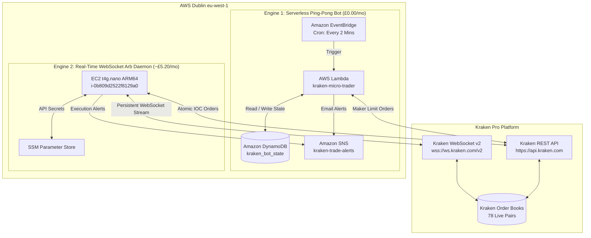
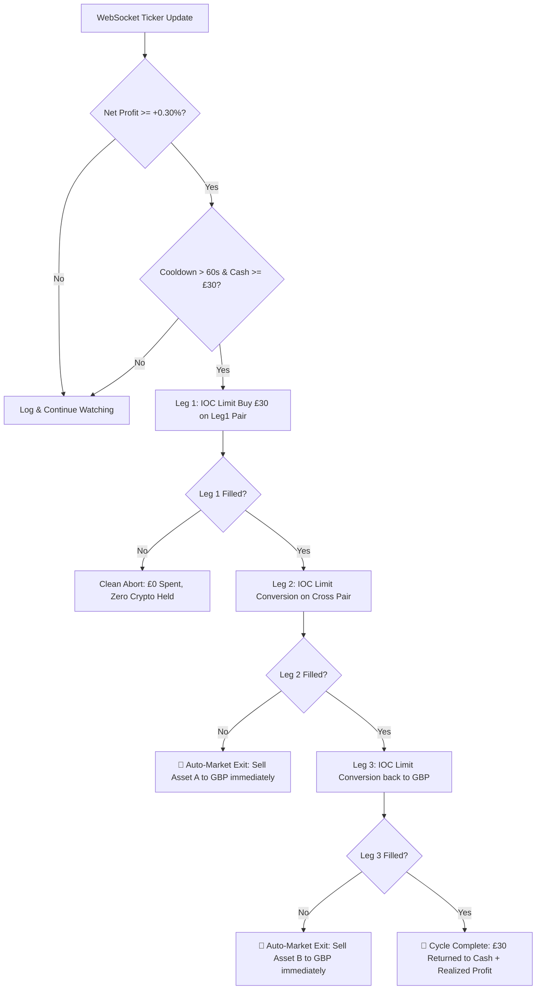

# Kraken Dual-Engine Autonomous Trading System

An institutional-grade, low-cost algorithmic trading platform executing two complementary strategies directly in **Pounds Sterling (£ GBP)** on **Kraken Pro**:

1. **Engine 1 (AWS Lambda, £0.00/mo):** Multi-Pair Volatility Ping-Pong Bot trading major pairs (`SOL/GBP`, `ETH/GBP`, `BTC/GBP`) using Maker limit orders and dynamic ATR volatility pricing.
2. **Engine 2 (AWS EC2 Dublin, ~£5.20/mo):** Real-time WebSocket v2 Triangular Arbitrage Daemon monitoring 57 triangles (78 pairs) with sub-15ms execution latency, dedicated to a ring-fenced **£30.00 capital pool**.

---

## 📚 Plain-English Beginner Guides ("Idiot's Guides")

If you are new to automated algorithmic trading, read these friendly, jargon-free guides:

* 📖 **[The Idiot's Guide to Triangular Arbitrage](docs/ARBITRAGE_EXPLAINED.md):** How your £30 turns into £30.25 in 2 seconds without gambling on crypto prices (the airport currency exchange analogy, real examples, fees, and safety nets).
* 📖 **[The Idiot's Guide to Volatility Ping-Pong](docs/PING_PONG_EXPLAINED.md):** How the bot buys dips, sells slight pumps, captures daily market waves, and why it costs £0.00 in cloud fees.

---

## 1. High-Level System Architecture



---

## 2. Comparison of the Two Engines

| Feature | Engine 1: Ping-Pong Maker | Engine 2: Triangular Arbitrage |
| :--- | :--- | :--- |
| **Strategy** | Mean-reversion grid / swing trading | Delta-neutral triangular price lag |
| **Execution Hosting** | AWS Lambda (Serverless) | AWS EC2 `t4g.nano` (Persistent daemon) |
| **Colocation** | Cloud general (`eu-west-1`) | Colocated in Dublin `<15ms` from Kraken |
| **Cloud Cost** | **£0.00 / month** (Free tier perpetual) | **~£5.20 / month** (£1.85 EC2 + £2.85 IPv4) |
| **Directional Risk** | Holds blue-chip crypto (`BTC, ETH, SOL`) during dips | **Zero directional risk** (holds crypto for <2 seconds) |
| **Order Style** | Passive Maker limit orders (0.25% fee) | Atomic Immediate-Or-Cancel (IOC) limit orders |
| **Cycle Duration** | Hours to days (market swing dependent) | **Sub-second** (300ms – 2 seconds) |
| **Target Profit** | `+0.80% – +3.00%` per completed cycle | `+0.30% – +1.50%` per completed triangle |
| **Capital Allocation** | Dynamic share of non-arbitrage equity | **£30.00** strictly ring-fenced |

---

## 3. Capital Partitioning & Ring-Fencing

Kraken accounts use a single unified British Pound wallet. To allow both bots to trade concurrently without fighting for capital, a strict mathematical ring-fence is enforced in software:

$$\text{Ping-Pong Equity} = \max(0, \text{Total Account Equity} - \mathbf{£30.00 \text{ (Arb Pool)}})$$

$$\text{Ping-Pong Tradeable Pool} = \max(0, \text{Ping-Pong Equity} - \mathbf{£2.00 \text{ (Fee Buffer)}})$$

$$\text{Per-Pair Ping-Pong Allocation} = \frac{\text{Ping-Pong Tradeable Pool}}{N \text{ (Active Pairs)}}$$

```
Total Kraken Equity: £78.78
 │
 ├── [Engine 2] Dedicated Arbitrage Pool:  £30.00 (Isolated, untouched by Ping-Pong)
 └── [Engine 1] Ping-Pong Equity:           £48.78
       ├── Permanent Uncommitted Fee Buffer: £2.00 (Safety floor for exchange fees)
       └── Tradeable Ping-Pong Pool:        £46.78
             ├── Pair 1 (SOLGBP):           £15.59 (Limit Buy active @ £88.62)
             ├── Pair 2 (ETHGBP):           £15.59 (Limit Buy active @ £2,020.50)
             └── Pair 3 (BTCGBP):           £15.59 (Filled! Limit Sell @ £63,909.60)
```

---

## 4. Engine 1: Multi-Pair Volatility Ping-Pong

### How It Works:
1. **Dynamic Volatility Pricing:** Evaluates the trailing 24-hour candlestick range (`(High - Low) / Low`). Takes 50% of the daily spread, capturing 75% of that half-spread (`Spread % * 0.375`). Clamped between `0.8%` and `3.0%`.
2. **Maker-Only Execution:** Every buy and sell is submitted with `oflags = post`. If an order would cross as a taker, Kraken rejects it automatically, ensuring we never pay more than 0.25% in fees.
3. **Automated Bank Deposit Detection:** On each 2-minute cycle, the bot checks if both cash and equity increased by $\ge £5.00$. If verified, it automatically scales up future orders and notifies you via email.
4. **No Panic Selling:** If a coin dips, the bot patiently holds the coins until the price recovers to the profit target.

---

## 5. Engine 2: Real-Time WebSocket Triangular Arbitrage

### How It Works:
1. **Sub-15ms Latency in Dublin:** The daemon maintains a persistent WebSocket v2 connection to `wss://ws.kraken.com/v2`.
2. **Continuous Tick Evaluation:** Evaluates both **FORWARD** (`GBP -> Asset A -> Asset B -> GBP`) and **REVERSE** (`GBP -> Asset B -> Asset A -> GBP`) cycles on every incoming price tick across 57 priority triangles.
3. **Net Profit Hurdle (+0.30%):** Enforces that net profit after all 3 trade fees must exceed +0.30%.
4. **Atomic 3-Leg Execution Pipeline with Emergency Rescue:**



* **Immediate-Or-Cancel (IOC):** Leg 1 is submitted with `timeinforce = "IOC"`. If the price moves or volume is unavailable, it cancels instantly. Zero money lost, zero crypto exposure.
* **Auto-Market Exit Safeguard:** If an intermediate leg fails, the engine triggers an instant market sell back to GBP, guaranteeing you never hold stranded cryptocurrency.
* **60-Second Cooldown:** Stops the engine from spamming orders if a pair's book becomes erratic.

---

## 6. Financial Model & Cloud Cost Economics

The EC2 virtual server hosting the arbitrage daemon costs **~£5.20 per month** (~17p / day). Because server cost is fixed and trade returns scale with balance:

| Capital Deployed | Return / Trade (+0.35%) | Monthly Gross (3 trades/day) | Cloud Cost | **Net Monthly Profit** |
| :--- | :--- | :--- | :--- | :--- |
| **£30.00** | £0.105 | £9.45 | £5.20 | **+£4.25** |
| **£50.00** | £0.175 | £15.75 | £5.20 | **+£10.55** |
| **£100.00** | £0.350 | £31.50 | £5.20 | **+£26.30** |
| **£250.00** *(Cap)* | £0.875 | £78.75 | £5.20 | **+£73.55** |

*(Plus, the Ping-Pong bot on Lambda is completely free and generates independent profits on major daily market swings).*

---

## 7. Daily Operations & CLI Cheat Sheet

### View Live Unified Dashboard:
```bash
python3 src/status.py
```

### Inspect EC2 Arbitrage Daemon via AWS Systems Manager:
```bash
# Check daemon service status
aws ssm send-command \
  --instance-ids "i-0b809d2522f8129a0" \
  --document-name "AWS-RunShellScript" \
  --parameters 'commands=["systemctl status kraken-arb.service --no-pager"]' \
  --region eu-west-1

# View recent live arbitrage logs
aws ssm send-command \
  --instance-ids "i-0b809d2522f8129a0" \
  --document-name "AWS-RunShellScript" \
  --parameters 'commands=["journalctl -u kraken-arb.service -n 30 --no-pager"]' \
  --region eu-west-1
```

### Inspect Lambda Ping-Pong Logs:
```bash
aws logs tail /aws/lambda/kraken-micro-trader --region eu-west-1 --follow
```

### Pause / Resume Ping-Pong Bot:
```bash
# Pause 2-minute EventBridge cron
aws events disable-rule --name kraken-trader-schedule --region eu-west-1

# Resume 2-minute EventBridge cron
aws events enable-rule --name kraken-trader-schedule --region eu-west-1
```

---

## 8. Automated Testing

The repository includes a comprehensive unit test suite covering capital sizing, volatility mathematics, triangular routing, IOC order lifecycles, and emergency liquidation safeguards:

```bash
# Run all unit tests
python3 -m unittest discover tests
```

---

## 9. Security & Safety Principles

1. **Restricted API Keys:** Uses Kraken API keys restricted to **"Query Funds"** and **"Create & Cancel Orders"** only. Withdrawal permissions are disabled.
2. **Encrypted Parameter Storage:** Kraken API keys are stored in AWS Systems Manager (SSM) Parameter Store as `SecureString` types encrypted with AWS KMS.
3. **No Inbound Network Ports:** The EC2 instance security group allows **outbound traffic only**. Management and shell access are handled entirely through encrypted AWS Systems Manager (SSM) agent sessions without opening SSH port 22.
4. **Permanent Cash Reserve:** Neither bot can touch the £2.00 cash buffer, preventing order rejections from fee depletion.
